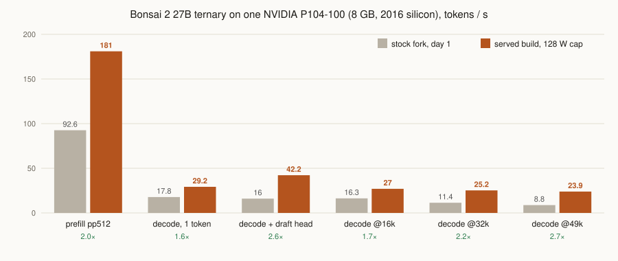

# P104-100 coding-agent inference: findings, recipe, and what we did

**A 27B model, 2.6× faster, on a €30 graphics card from 2016, with its logits within 3.6e-4 KL of the reference.**



This is the complete record of a two-day program that turned a single **NVIDIA P104-100** (GP104,
compute capability 6.1, 8 GB GDDR5X, PCIe Gen1 x2 on this host, passively cooled mining card) into a
coding-agent inference engine for **Bonsai 2 27B** (PTQ1_0 ternary): the kernels, the serving recipe,
the verification method, every measurement, and every idea that did not work. Each change was proven
on op tests and logit divergence against the reference before it counted. What that proves and what
it does not: mean KL divergence of 3.6e-4 and 99.6 % top-1 agreement on the evaluated code tokens
show the served build's logits are close to the reference's; they do not by themselves establish
equal outcomes on coding tasks. A task-level scoreboard is the next piece of evidence (see
"What comes next").

Who this is for:

* the student or tinkerer on a budget who wants a real AI or coding agent at home: a used P104-100
  costs about €30, draws 128 W here, and runs a 27B model at 42 tokens per second on code; everything
  needed to do that is in this repository, free for noncommercial use;
* teams sitting on older or surplus GPUs who want a verified number for what they can really do;
* builders of coding agents who need local inference with long context at low cost and low power;
* anyone working on Pascal, ternary formats, speculative decoding, or llama.cpp CUDA kernels, who
  wants the measurements and the dead ends without repeating two days of work.

Work done 23–24 November 2026 on the GPU host (`gpu-host`), by one coordinator and eleven specialist
agents on a serialized GPU queue. The same method ports to other cards and models; see
`COMMERCIAL.md` if you want it applied to yours.

## Quick start

Have an Ubuntu machine with a P104-100 (8 GB exposed) and the NVIDIA driver installed? Then:

```
git clone https://github.com/mambiux/p104-coding-agent-inference
cd p104-coding-agent-inference
bash install.sh
```

It installs the toolchain, builds the patched fork for this card, downloads the model, caps the
power, and starts the server with the stock web UI. Details, options and troubleshooting: `GUIDE.md`.

## Results (same card, same model file)

| Measure | Day 1, stock fork | Served build (`best8`) | Change |
|---|---:|---:|---:|
| Prefill, pp512 | 92.6 tok/s | 181 | +95 % |
| Decode, single token | 17.8 | 29.2 | +64 % |
| Decode with native draft head, code | 16 | 42.2 | 2.6× |
| Short prompt, full serving recipe | 46.4 (reference) | 50.3 | +8 % |
| 30k-token edit turn | 20.2 (reference) | 23.5 | +16 %; +39 % more on partially accepted edits |
| Decode at 16k / 32k / 49k context | 16.3 / 11.4 / 8.8 | 27.0 / 25.2 / 23.9 | 1.7× / 2.2× / 2.7× |
| Context on the card | 20k (f16 cache) | 48k (4-bit caches) | 2.4× |
| Power under load | ~180 W | 128 W cap | −29 % |
| Memory clock | 5005 MHz | 5054 MHz | +100 offset; gated ladder clean to +200 |
| Logit agreement vs reference | — | KLD 3.6e-4 mean, top-1 99.6 % | measured on 2k code tokens |

All speeds in tokens per second. Two baselines are mixed in this table and are labelled: "Day 1,
stock fork" is the unmodified PrismML fork as first measured (llama-bench, stock power); rows marked
"(reference)" compare the served build against the reference build in the same interleaved job at
128 W with the same serving recipe, which is the fair kernel-to-kernel comparison. Exact
configurations for every row are in the bench page.
The full tables, including every intermediate measurement, are in `docs/bench-and-findings.html`;
the one-page summary is `docs/program-report.html`.

Also measured: **Qwen3.5-9B Q5_K_M** on current upstream llama.cpp built for this card
(prefill 496 tok/s, decode 25.4 / 22.1 / 18.5 at 0 / 16k / 49k, 64k context fits with 1.1 GB
spare, 30k edit turn 29.1 tok/s). It is the Hermes-Agent-capable configuration on 8 GB, which the
27B is not (Hermes requires 64k).

## The recipe

### Base

* Fork: `PrismML-Eng/llama.cpp`, branch `prism`, commit `d12ca13bb` (2026-11-20). The ternary
  (PTQ1_0) formats and the native MTP draft head live there.
* Model: Bonsai 2 27B PTQ1_0 "Condensed" with the native MTP head, plus the one-row "thinking-close"
  edit of `output.weight` ported byte-exactly (see the model lane notes).
* Card: P104-100, VBIOS 86.04.7A.00.47 (signed, never cross-flash), driver 580.

### Build

```
cmake -B build -DCMAKE_BUILD_TYPE=Release -DGGML_CUDA=ON -DCMAKE_CUDA_ARCHITECTURES=61 \
  -DGGML_NATIVE=OFF -DLLAMA_CURL=OFF -DGGML_CUDA_FA_ALL_QUANTS=OFF \
  -DGGML_CUDA_FA_QUANTS="q4_0-q4_0;q8_0-q8_0;f16-f16;bf16-bf16;q8_0-q4_0" \
  -DGGML_CUDA_GRAPHS=ON -DGGML_CUDA_COMPRESSION_MODE=size
cmake --build build --config Release -j 2 --target llama-server llama-bench test-backend-ops llama-perplexity
```

Apply `patches/best8-cumulative-vs-prism-d12ca13bb.patch` to the fork first (`patch -p1`). It
contains everything that is serving: the ternary decode kernel, the Pascal flash-attention decode
kernel with its gates, the prefill tile with its dispatch threshold, the multi-column verify kernel
with the accumulator fix, the device-resident recurrent checkpoint in the server, and the tests.

Two build gotchas that cost us hours: `llama-server` is a stub, the server code is in
`libllama-server-impl.so`, so copy the libraries, not just the executables; and on a host where the
compiler segfaults (this one did, three different compilers), build with `-j 2` in a retry loop.

### Serve

`scripts/serve/bonsai-serve-best2.sh`, run by `scripts/system/bonsai-best.service`:

```
llama-server -m <model> --host 0.0.0.0 --port 8097 -ngl 999 --ctx-size 49152 --parallel 1 \
  -b 512 -ub 256 -fa on --cache-type-k q4_0 --cache-type-v q4_0 --jinja \
  --spec-type ngram-mod,draft-mtp --spec-draft-n-max 3 --spec-draft-n-min 0 --spec-draft-p-min 0.75 \
  --reasoning on --reasoning-effort medium --reasoning-budget 4000 \
  --reasoning-budget-message "Time to stop thinking and write the final answer now." \
  --temp 0.7 --top-p 0.95 --top-k 20 --cache-reuse 256
```

with `LLAMA_SPEC_CKPT_DEVICE_PLANE=1` in the environment (device-resident recurrent checkpoint,
+39 % on edit turns with partial acceptance, +156 MiB) and `CUDA_VISIBLE_DEVICES` pinned to the
card's UUID (CUDA enumerates GPUs in a different order than `nvidia-smi` on this host).

Why these values:

* **48k context, 4-bit K and V.** 64k loads but leaves no headroom: the GPU memory pool grows
  mid-request and the server aborts. K q8_0 / V q4_0 has better quality per byte (KLD 4.4e-4 vs
  1.1e-3 at 16k) but fits only to ~49k. Retrieval of 8 planted keys across a 30k prompt is 8/8 with
  either.
* **ub 256.** The prefill tile is tuned for it; smaller saves little memory (76 MB at ub 128).
* **n-gram + native MTP head, depth 3, p-min 0.75.** Edit turns 43 → 59.5 tok/s on the reference
  build; fresh code 40 → 43; prose unchanged.
* **Reasoning medium, budget 4000.** On short tasks the effort level and the thinking-close edit
  made no measurable difference; blow-ups are a long-deliverable phenomenon, so the budget message
  stops them.
* **No GPU-side sampling.** `-bs` showed +5 % with greedy output and 0 % with the real sampler.

### Power and clocks

* `nvidia-smi -pl 128`: 128 W gives ~93 % decode and ~90 % prefill speed of the 180 W stock limit
  for ~70 % of the power. No knee exists (the memory clock is fixed), so the choice is a budget.
* Memory offset +100 via NVML (`scripts/system/p104-memoc-set.py`), applied at boot by
  `p104-power-cap`. The gated ladder (`scripts/tune/memoc-conservative.sh`: 8 GB memory test,
  bandwidth probe, logit divergence vs stock, driver log, temperature) was clean through +200; the
  offset applies at roughly half its nominal value and the gain in this range is inside run-to-run
  noise. It is a safe setting with margin, not a speed-up.

### Switching between serving and research

`scripts/system/bonsai-cutover <bin-dir>` pauses the GPU job queue (requeues the interrupted job,
kills the card's processes by `nvidia-smi` index) and starts the unit; `bonsai-queue-resume` does
the reverse. The queue (`scripts/queue/`) runs one job at a time under a file lock, each job in its
own process session that is killed at job end (three incidents of orphaned samplers holding the lock
taught us that), with name-based timeouts (20 min default, 50 min for `*merge-verify*`).

### Verification battery

`scripts/tune/merge-verify-fast.sh <bin> <label>` (~38 min) and the candidate-only variant
`merge-verify-cand.sh` (~18 min): `test-backend-ops` for the ternary mat-vecs and flash attention,
interleaved `llama-bench` at 0 / 16k / 32k depth, KL divergence of logits against the reference on
code tokens, two serving turns (short prompt, 30k-token edit) with draft acceptance, and a temp-0
text compare. Nothing shipped without it.

## Reproduce in an hour

1. Clone the PrismML fork at `d12ca13bb`, apply `patches/best8-cumulative-vs-prism-d12ca13bb.patch`.
2. Build with the flags above (`-DCMAKE_CUDA_ARCHITECTURES=61`, the listed `GGML_CUDA_FA_QUANTS`).
3. Get the Bonsai 2 27B PTQ1_0 file with the native MTP head; port the thinking-close edit if you want
   it (model lane notes).
4. Run `scripts/tune/merge-verify-cand.sh <bin> <label>` against the reference build: it prints the
   same op tests, benches at depth, KL divergence and serving turns reported here. If your numbers
   match the tables, serve with `scripts/serve/bonsai-serve-best2.sh`.

## What was built

| Lane | What | Measured |
|---|---|---|
| Ternary decode kernel (sm_61) | octet geometry, dp4a decode, CUDA graphs, FWHT fusion | 1.65× decode, 2× prefill over stock |
| Flash-attention decode kernel for Pascal | native for quantized KV, 1-token path at every depth, 2–4-token verify path above 4k KV | attention at 61k: 6.0 → 0.6 ms per layer; decode at 49k 8.8 → 23.9 |
| Prefill tile | ternary MMQ tile for sm_61, dispatch at n ≥ 128 with a full-tile check | +9 % prefill; the n ≥ 64 gate it first shipped with cost 2 tok/s on verify batches |
| Multi-column verify kernel | 2–4 columns share one weight pass; pre-biased accumulators | n = 2–4 cost 1.04–1.11× n = 1 instead of 1.4–2.7×; MTP depth 2: 36.7 → 42.2 |
| Device-resident recurrent checkpoint | server passes the fork's existing `ON_DEVICE` state flag on the speculative path | save 389 → 16 ms; edit turns +39–41 %; restore proven; text identical |
| Model lane | KV-type matrix, thinking-close port, tool calling (5/6), spec-flag sweep | serving choices above |
| Hardware dossier | NVML / BAR0 read-only probes, VBIOS parse, link training, SM/TPC masks | PCIe Gen1 x2 on this host; 15 SMs; memory offset range ±2000 |

Each lane's own notes and patch are under `lanes/`.

## What was ruled out, with data

The single-token decode kernel (92 µs on 17408×5120, ~70 % of memory bandwidth) had every
structural alternative built and measured against it:

| Idea | Result |
|---|---|
| Register cap / occupancy | −1.8 % |
| Persistent grid-stride rows | −3.5 % |
| K-split S=2 / S=4 (longer DRAM runs) | −18 % / −37 % |
| Weight repack | not pursued: longer runs made it slower, so it is not access-pattern bound |
| Permute-free decode | −9.5 % (PRMT costs nothing on this card) |
| 2-deep weight prefetch | −7 % capped, −14 % uncapped |
| Activation-stationary verify (n = 2–4) | −40 %: already issue/latency-bound at ~2 warps/scheduler |
| Direct load, no shared-memory staging | ±4 % |

Probes: 52 µs with weight loads removed, ~65 µs for the weight stream alone; the probes are not
additive (removing work changes scheduling), but they point at the per-step staging hand-off
(loads → registers → shared memory → sync → loads) as what keeps compute and the weight stream from
overlapping, and Pascal has no asynchronous copy to break it. These results rule out the designs we
tested under these conditions; they do not prove the kernel cannot be improved. Untested directions
are listed under "What comes next".

Also rejected: GPU-side sampling (no gain with the real sampler), activation sparsity (KLD
0.019–0.088), LM-head shortlist, L2 persistence (unsupported on cc 6.1), PQ2_0 pack (same quality,
1.3 GB bigger), a build without the native mixed-KV attention instance (slower on short prompts),
64k context on 8 GB (loads, aborts under load).

## Ready but not landed

* `lanes/fusion/fusion.patch`: three graph-level fusions (norm → FWHT → q8 in the mat-vec's layout,
  residual add folded, GDN tail in one kernel), bit-identical after a rounding-order fix, launches
  1135 → 887, +1.3–1.5 % decode. Plus an sm_61 bf16 mat-vec kernel for the two SSM projections that
  run 4.7× off bandwidth (≈ +2 %), written and compiling but never run on the card (opt-in).
* `lanes/fa/chunked-prefill.wip.patch`: chunked prefill attention to reclaim ~190 MiB at 64k. Treat
  64k on 8 GB as an experiment: 190 MiB is not shown to cover the whole request lifecycle (prefill,
  drafting, rejection, restore, long generation); peak-allocation profiling comes first.

## What comes next

Measured in tasks completed per hour on the same card, not tokens per second. In order:

1. **A fixed coding-task suite** (30–50 tasks: bug fixes, edits, tool calls, browser deliverables)
   run against the stock fork, the served build and the 9B configuration, with elapsed time and
   energy per passing task. Every later change is judged by it.
2. **Diagnostics inside the agent loop**: after each edit, run the parser, linter, type checker,
   targeted tests and, for UI work, the headless browser; feed concise failures back. The game test
   above is the evidence: a duplicate-key bug survived two symptom-only repair rounds and fell in one
   round once the root cause was stated.
3. **Adaptive speculation**: per-stage telemetry (draft, verify, checkpoint/restore, committed
   tokens) and a controller that picks the draft depth per workload by cost per committed token,
   with hysteresis, compared against the best fixed depth on held-out work. Edits, fresh code and
   prose already behave differently here.
4. **Context reuse**: stable prefixes first, measured prefix-cache hits, prefill avoided on repeated
   repository content.
5. **Land the pending kernels one at a time**: the fusion patch, then the bf16 projection kernel.
6. **Memory headroom by measurement**: peak allocations through the whole request lifecycle, then
   admission limits, then a worst-case soak with no OOM.
7. **Kernel bets still open**: wider weight-sharing verification tiles (4–8 columns, measured with
   recurrent-state and rollback costs included); a 27-entry ternary lookup via warp registers and
   shuffles (a Pascal-specific experiment, cost of table construction included); KV-tile reuse
   across verification queries at 16k–49k depth. Each with the same proof bar.

## Lessons

* Prove every kernel change three ways: op tests, logit divergence, and a serving A/B with the real
  drafting recipe. Two of our merges looked fine on benches and lost speed in serving.
* A fix loop driven only by symptoms stalls on silent bugs. The served model fixed a white-screen bug
  from symptoms but never found a duplicate object key that made coordinates NaN; told the root
  cause, it fixed it in one round. Put a linter in the loop.
* On a multi-GPU host, pin `CUDA_VISIBLE_DEVICES` to a UUID in every script; CUDA and `nvidia-smi`
  order the cards differently.
* Hidden stderr hides crashes. Keep it in the job log.
* A suspect host (compiler segfaults in three different binaries) can still produce correct
  artifacts if every build is retried and every artifact is verified. This is an unresolved
  reliability issue, not a solved one: the host's memory has not been tested yet, and the builds
  should be reproduced on a stable machine before anyone depends on them.

## Layout

```
docs/      program-report.html, bench-and-findings.html, the one-shot game and its fixed version
patches/   best8-cumulative-vs-prism-d12ca13bb.patch  (everything that is serving)
lanes/     per-lane patches and notes (fa, prefill, arch2, arch3, rs, fusion, mtp, mv, best, ...)
scripts/   serve/ (launchers), system/ (units, power cap, memory offset, cut-over), queue/ (gpuq),
           tune/ (verification battery, sweeps, ladders)
GUIDE.md   what you need and what install.sh does; install.sh sets a fresh Ubuntu box up end to end
harness/   headless-browser tests for generated pages and games, fix loop, grader
```

Model files are not included. The base fork and the model are public; the machines in the scripts
are ours (`gpu-host` = the card's host; the tailnet addresses were replaced with placeholders).

## Credits

This work stands on the [PrismML](https://github.com/PrismML-Eng/llama.cpp) fork of llama.cpp and
its ternary formats; on the Bonsai 2 27B model from [PrismML](https://huggingface.co/prism-ml) (the
served file is a community condensed and edited variant, see the model lane notes); on
[llama.cpp](https://github.com/ggml-org/llama.cpp) itself; and on NVIDIA's GP104, a chip that holds
more than they led us to believe. Our only contribution was to go looking.

## License

PolyForm Noncommercial 1.0.0: free for noncommercial use with credit to the author; commercial
use requires a paid license (team €990/yr, department €4,900/yr, product €14,900/yr, port
engagements from €9,800), see `COMMERCIAL.md`. Third-party components (llama.cpp, the PrismML
fork, the Bonsai model) keep their own licenses.
